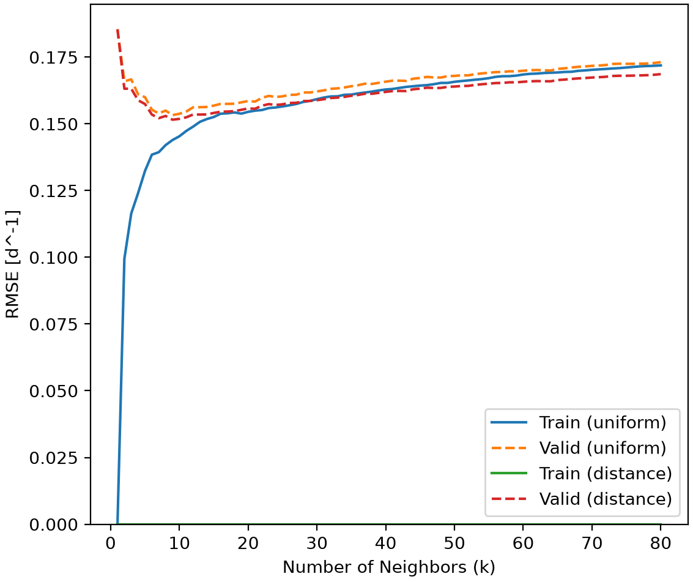
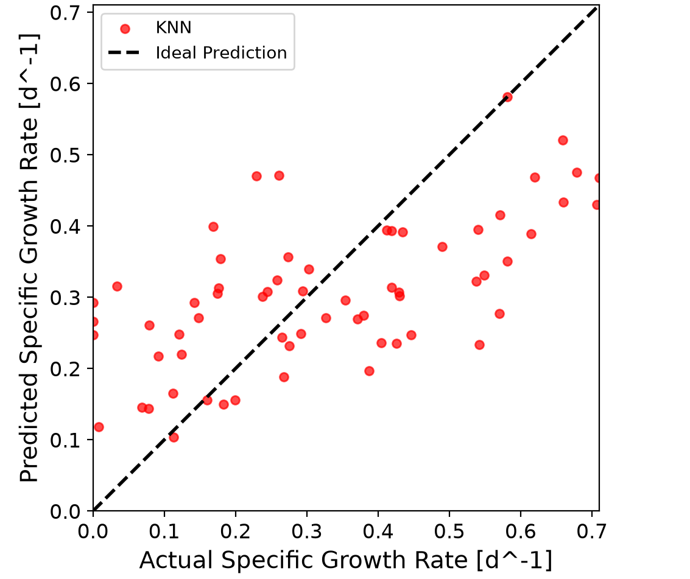

# Cell Growth Rate Prediction
This project uses machine learning to predict the specific growth rate of cells from four biochemical operating variables, temperature, pH, glucose and lactate concentration. A dataset of 318 observations is used to train and compare linear, polynomial and KNN regression models. The program selects model settings through four-fold cross validation and exports prediction figures and CSV results.

## Highlights

- Built three regression models for cell growth prediction
- Standardized four biochemical operating variables using pipelines
- Optimized polynomial degrees and KNN neighbor settings
- Compared regression models using four-fold cross-validation
- Exported a variety of prediction figures and CSV results

## Environment
- Python 3.14.7
- Matplotlib 3.11.0
- NumPy 2.5.2
- pandas 3.0.5
- scikit-learn 1.9.0

## Code Design

### Dataset Import and Preparation

The program begins by importing the dataset using the pandas library and storing it as a DataFrame. The specific dataset has 318 observations with specific growth rate as the target variable and temperature, pH, glucose and lactate concentration as the four features.

The feature and target columns are converted to numpy arrays before being divided into training and testing sets using train_test_split(). An 80/20 split produced 254 training observations and 64 testing observations. The random_state=0 parameter ensures the same split is generated every time the program is run, improving reproducibility. 

### Preprocessing and Cross-Validation

Each regression model uses a pipeline containing StandardScaler() to standardize the four input features. This is particularly important for KNN regression because it calculates distances between observations. Without scaling, some variables could dominate those distances, affecting which observations are considered neighbors.

The make_pipeline() function combines standardization and regression into a single workflow. During cross-validation, the scaler is fitted only on the training portion of each fold, preventing data leakage from the validation observations.

Four-fold cross-validation is performed using the training dataset. The data is divided into four subsets, with each subset used once for validation and the reamining three are used for training. This would provide a more reliable estimate of model performance than relying on a single split. 

### Regression Models

Three regression models were implemented to compare their ability to predict cell growth rates.

Linear regression was used as a preliminary model, with cross_validate() evaluating its training and validation performance using four-fold cross-validation. Across the folds, the mean of the training and validation RMSE and R^2 are used.

Polynomial regression was implemented using PolynomialFeatures() and LinearRegression() to account for nonlinear relationships and interactions between the input features. GridSearchCV was used to evaluate polynomial degrees ranging from 1 to 4 and select the degree with the lowest validation RMSE.

Finally, KNN regression was implemented using KNeighborsRegressor(), which predicts growth rates based on nearby observations. GridSearchCV evaluated neighbor counts ranging from 1 to 80, along with uniform and distance weighting methods, resulting in 160 hyperparameter combinations. For comparison, the search uses the four-fold cross validation and RMSE scoring so that it can be evaluated against polynomial regression.

Linear, polynomial and KNN regression used four-fold cross-validation and negative RMSE as the scoring metric to identify their optimal hyperparameters.

### Model Evaluation and Visualization 
The regression models were compared using their four-fold cross-validation RMSE values, with lower values indicating better predictive performance (smaller errors). The optimized KNN model was then evaluated using the independent testing dataset. Root mean squared error (RMSE) and the coefficient of determination (R^2) were calculated using root_mean_squared_error() and r2_score().

Two figures were generated using Matplotlib. The first displays the training and validation RMSE for KNN regression as the number of neighbors increases, comparing uniform and distance weighting. This helps visualize the influence of hyperparameters on model performance.

The second figure compares actual and predicted specific growth rates, with a diagonal line representing perfect predictions. This allows prediction errors to be examined visually vs an ideal case.

### Exporting Results

The program exports model evaluation and hyperparameter optimization results into CSV files using the pandas to_csv() method. Four tables are generated, containing the optimized KNN model summary, all KNN hyperparameter search results, regression model comparison, and polynomial regression hyperparameter search results.

These files are saved in the tables directory, allowing the results to be reviewed and compared without rerunning the Python program.

## Analysis

### Polynomial Regression

Polynomial regression was evaluated using degrees ranging from 1 to 4. The purpose was to determine whether introducing nonlinear terms and interactions between the four input features would improve the prediction of specific cell growth rates.

| Polynomial Degree | Validation RMSE (d⁻¹) |
|---|---:|
| 1 | 0.173879 |
| 2 | 0.154229 |
| 3 | 0.164520 |
| 4 | 0.228910 |

The second-degree polynomial achieved the lowest validation RMSE of 0.154229 d⁻¹ and a mean_train_score of 0.129853, outperforming the first-degree model. This suggests that nonlinear relationships between the operating variables and cell growth rate are important for improving predictive accuracy. 

However, increasing the polynomial degree beyond 2 resulted in worse validation performance. The fourth-degree polynomial produced the highest validation RMSE of 0.228910 d⁻¹. Despite the 4th degree model having a lower mean_train_score of 0.111097, this could indicate overfitting, where a model becomes overly complex and captures patterns or noise specific to the training data rather than relationships that generalize well to unseen observations.

These results demonstrate the bias-variance tradeoff. Simpler models may underfit by failing to capture nonlinear relationships, while overly complex models may overfit the training data. The second-degree polynomial provided the best balance between model complexity and validation performance among the degrees tested.

### Comparison of Regression Models

Three regression models were evaluated using four-fold cross-validation to determine which approach provided the most accurate predictions of specific cell growth rate. Root mean squared error (RMSE) was used as the primary evaluation metric, where a lower RMSE indicates better predictive performance.

| Regression Model | Validation RMSE (d⁻¹) |
|---|---:|
| Linear Regression | 0.173879 |
| Polynomial Regression (Degree 2) | 0.154229 |
| KNN Regression (k = 9, Distance) | 0.151549 |

Linear regression produced the highest validation RMSE of 0.173879 d⁻¹, indicating that a simple linear relationship was insufficient to accurately describe the variation in cell growth rate. Its relatively low validation R² of 0.084 further suggests that the model was unable to capture much of the variation in the dataset.

Polynomial regression improved predictive performance, achieving a validation RMSE of 0.154229 d⁻¹ using a second-degree polynomial. This suggests that nonlinear relationships and interactions between the operating variables may be important when predicting cell growth.

KNN regression achieved the lowest validation RMSE of 0.151549 d⁻¹, representing approximately a 12.8% improvement over linear regression. However, KNN only improved upon polynomial regression by approximately 1.7%, indicating that both nonlinear approaches provided similar predictive performance.

Based on cross-validation RMSE, KNN regression was selected as the best-performing model for further evaluation as it has the lowest cross-validation RMSE.

### KNN Hyperparameter Optimization

KNN regression was optimized using GridSearchCV with four-fold cross-validation. The hyperparameter search evaluated neighbor counts ranging from 1 to 80 and two weighting methods: uniform and distance. This produced 160 possible combinations, with the goal of identifying the configuration with the lowest validation RMSE.

The optimal model used 9 nearest neighbors with distance weighting, achieving a validation RMSE of 0.151549 d⁻¹. Distance weighting gives greater influence to observations that are closer to the prediction point, allowing the model to account for local relationships in the dataset.

The figure shows that validation RMSE generally decreases as the number of neighbors increases from 1, reaching its minimum near 9 neighbors for distance weighting. Beyond this point, validation error gradually increases, suggesting that using too many neighbors can cause underfitting by producing overly smoothed predictions.

An interesting observation is that distance-weighted KNN maintains a training RMSE of approximately zero across all neighbor counts. This occurs because training observations are included as their own nearest neighbors, giving them zero distance during prediction.

However, a zero training error does not indicate perfect predictive performance. The validation RMSE provides a more meaningful measure of how well the model generalizes to unseen observations.

### Actual vs. Predicted Growth Rates

The optimized KNN model was evaluated using the independent testing dataset, which contained 64 observations. The model achieved a test RMSE of 0.159 d⁻¹ and an R² of 0.371. This indicates that the model accounts for approximately 37.1% of the variation in specific growth rate within the testing dataset, leaving a large amount of variation unexplained.

The diagonal line in the middle of the figure represents the ideal predictions where the predicted specific growth rates are equal to the actual specific growth rates. Points above the line are overpredictions, with them having a predicted value greater than the ratio of 1 when they are equal. Points below the line are considered underprediction, for the same reason, as the predicted over actual ratio is less than the ideal ratio of 1. A notable observation is that the KNN model tends to overpredict lower actual specific growth rates and tends to underpredict the larger actual specific growth rates, with a cluster around the center of the figure.

The model may have difficulty repdoucing extreme values if neighboring training samples have lower growth rates. The model therefore has some predictive ability, but great errors still persist.

### Influence of Biochemical Operating Variables

The four input variables affect growth in different ways, and their relationships are not always linear. Temperature influences reaction rates, while pH affects the environment in which cellular enzymes and other processes operate. Growth may improve near more favourable ranges but will decrease when conditions become too extreme such as higher or colder temperatures and/or pH.

Glucose acts as a nutrient for cell growth. Consequently, very low glucose availability can limit growth. Increasing glucose can increase the growth rate, however this may not occur if another condition is limiting. Additionally, a higher accumulation of lactate can inhibit and limit cell growth rates. All parameters can have positive and/or negative effects on cell growth depending on conditions and combinations.

### Model Limitations and Engineering Applications

Although KNN performed the best in the comparison, its test R^2 of 0.371 and the scatter plot of actual vs predicted show that its accuracy is limited. Additionally, there could be other relevant biological or process variables that are not included in the inputs. Further relevant factors could include cell type, age, substrate, where the model does not account for this.

KNN relies on nearby observations, so predictions are less reliable when operating conditions lie outside the sampled ranges or in poorly represented regions. There exists great uncertainty as the model commonly overpredicted low growth rates and underpredicted higher growth rates. Even if the prediction seems reasonable, it may not be safe or optimal such as the cluster of points in the middle, which still tended to either under or overpredict the growth rates.

A pratical use for the model could be a preliminary screening of cell culture conditions. It could assist in comparing combinations of temperature, pH. glucose and lactate before selecting conditions for additional experiments. However, final predictions should be tested in real cultures before being used. The model could be improved by introducing more observations and data, broader operating conditions and additional process variables. These would improve the model's ability to predict growth rates more accurately.

Overall, non-linear regression methods held a considerable advantage over the linear regression initially tested. Narrowing it down, KNN with nine distance-weighed neighbors produced the lowest validation RMSE, however polynomial regression with degree 2 performed nearly as well and may be easier to implement. To conclude, the model is most capable as a exploratory tool into predicting the growth rates for this dataset.